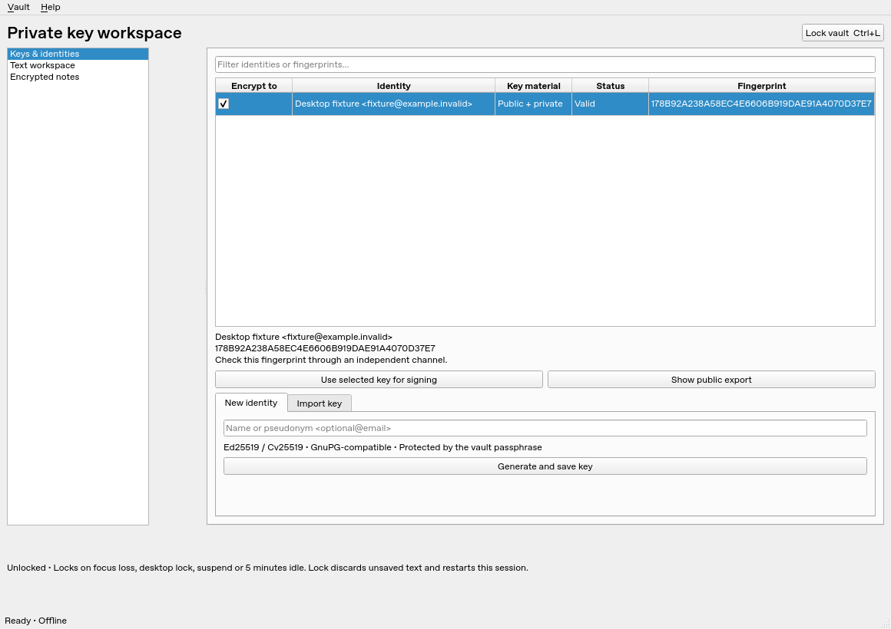

# PGPCrypt

A Debian 13 desktop app for keeping public **and** private OpenPGP keys,
identities, and notes inside one encrypted vault. It has a Qt6 interface inspired
by KGpg and a separate Rust worker for vault and OpenPGP operations.

**Application alpha:** use disposable keys pending further hardening/review.
The encryption container is now the established **age v1 format**, implemented by
`age` 0.12.1. We no longer write the custom alpha1 encryption format.



## Install a compiled package — no Rust required

On **Debian 13 amd64**, after downloading the `.deb`, run:

```sh
cd ~/Downloads
sudo apt update
sudo apt install ./pgpcrypt_0.1.0~alpha2_amd64.deb
pgpcrypt
```

APT installs runtime libraries. You do **not** install Rust, Cargo, rustup, Qt
build tools, or a compiler to run the package. Launching from the application
menu also works. Remove the app with `sudo apt remove pgpcrypt`; this leaves
user-created vaults alone.

Published binary downloads belong under
[GitHub Releases](https://github.com/aa1967/PGPCrypt/releases). A cloud environment
publication does not create a GitHub Release. If no `.deb` is attached there,
use a locally supplied package or build the published source using the commands
below. Do not assume a release download exists just because this README describes it.

## Clone, build, and install entirely from the command line

These commands retrieve the code **after it has been pushed to GitHub**:

```sh
sudo apt update
sudo apt install -y git ca-certificates
git clone https://github.com/aa1967/PGPCrypt.git
cd PGPCrypt
./scripts/install-debian.sh --build
pgpcrypt
```

The installer gets the build tools, including Debian's Rust **1.85.1**, from APT;
it builds a `.deb` and installs it. There is no website visit or separate Rust
installer. On a non-root account it uses `sudo` for package operations only.

For the fully explicit equivalent, including all build prerequisites:

```sh
sudo apt update
sudo apt install -y git ca-certificates build-essential pkg-config libssl-dev \
  clang libclang-dev qt6-base-dev qt6-wayland rustc cargo python3 binutils \
  dpkg-dev desktop-file-utils libsodium-dev age gnupg
git clone https://github.com/aa1967/PGPCrypt.git
cd PGPCrypt
./scripts/build-deb.sh
sudo apt install ./dist/pgpcrypt_0.1.0~alpha2_amd64.deb
pgpcrypt
```

Skip the second clone if you already used the first command block. To build
without installing, stop after `build-deb.sh`, or use `build-desktop.sh` followed
by `run-desktop.sh` in a graphical desktop session.

If cloning retrieves only a README, the implementation has not reached that
branch yet. See [publishing and viewing on GitHub](docs/PUBLISHING.md).

## Vault format and Rust choice

New vaults use **standard age v1 passphrase encryption**: scrypt password
hardening and authenticated ChaCha20-Poly1305 encryption. PGPCrypt sets scrypt
`N=2^18, r=8, p=1` (approximately 256 MiB) and caps accepted work factors at 18.
Every save creates a fresh age file key and salt through the library. All key
bytes, names, emails, fingerprints, notes, and schema metadata are encrypted.
Only age framing, KDF parameters, size, filename and filesystem metadata remain
visible. There is no custom crypto header or plaintext keyring index.

Rust is useful for reducing memory-safety bugs in the worker; it is not a
security requirement for the user to install, and it is not a runtime dependency.
C++ could also use sound crypto libraries. Keeping the existing Rust/Sequoia core
lets us retain tested OpenPGP support while shipping ordinary native binaries.
The unused egui implementation and its dependencies have been removed.

See the [accepted format decision](docs/ADR-001-vault-format.md),
[file/schema specification](docs/VAULT_FORMAT.md), and
[security boundaries](docs/SECURITY.md). An established encryption format does
not make the entire application audited or production-ready.

## Use and migrate

Create a new file such as `/home/you/Documents/private.pgpcrypt.age` in a directory
you control. Use at least 16 characters; prefer several randomly chosen words.
There is no password reset. Back up the encrypted vault while closed.

The app generates/imports keys, merges certificate updates, displays policy status
and full fingerprints, supports text encrypt/decrypt/sign/verify, and saves notes.
Locking ends both the session UI and worker and starts a fresh locked UI. Unsaved
editor contents are discarded. Private-key imports necessarily pass through GUI
buffers; clipboard managers and a compromised desktop can capture plaintext.

Alpha1 files are recognized but never opened or rewritten by the normal app.
Convert a backup to a **new** age file using the packaged recovery tool:

```sh
pgpcrypt-migrate /path/old.pgpvault /path/new.pgpcrypt.age
```

It prompts privately for the old and new passphrases. Never pass passwords as
command arguments. The original is unchanged; verify the new vault before
retiring any backup.

## Development checks

Install optional developer tools with `sudo apt install -y rustfmt rust-clippy`.
Then, from the checkout:

```sh
./scripts/dev.sh test --locked --all-features -j 4
./scripts/dev.sh fmt --all -- --check
./scripts/dev.sh clippy --locked --all-targets --all-features -- -D warnings
./scripts/build-desktop.sh
python3 tests/age_interop.py
QT_QPA_PLATFORM=offscreen ./scripts/run-desktop.sh --self-test
QT_QPA_PLATFORM=offscreen ./scripts/run-desktop.sh --test-lock-restart
./scripts/build-deb.sh
python3 scripts/check-deb.py dist/pgpcrypt_0.1.0~alpha2_amd64.deb
```

`age_interop.py` uses Debian's independent Go age CLI with disposable fixtures;
it does not send real keys to external programs. GnuPG tests use a temporary
keyring. The [Debian CI workflow](.github/workflows/debian.yml) builds artifacts
when run on GitHub; it does not publish releases automatically.

The cloud-only bootstrap scripts extract authenticated Debian compiler/Qt packages
under `/workspace/.pgpcrypt-tools` without changing the system installation.
Ordinary users use the APT instructions above.

## View the project on GitHub

- [Code and README](https://github.com/aa1967/PGPCrypt): files must be committed
  and pushed to the selected branch to appear here.
- [Actions](https://github.com/aa1967/PGPCrypt/actions): CI logs and downloadable
  build artifacts after a workflow runs.
- [Releases](https://github.com/aa1967/PGPCrypt/releases): downloadable `.deb`
  files only after a maintainer publishes a release.

GitHub shows source, screenshots, and downloads. Run this native desktop app
locally to interact with it. Publishing a Codex environment saves a development
snapshot; it does not push commits or make the desktop run on GitHub Pages.

Full file workflows, hardware factors, recovery options, broader key management,
and real GNOME/Plasma lock/suspend validation remain in the development plan.
